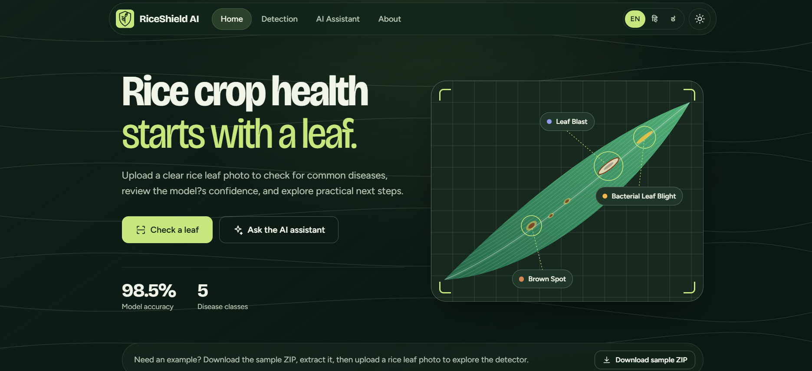
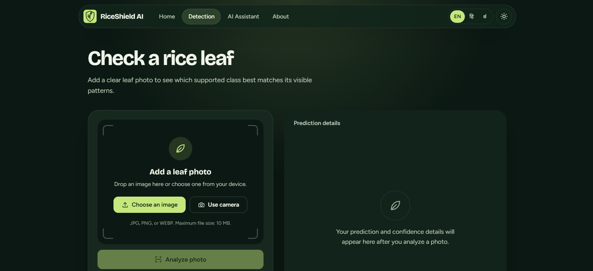
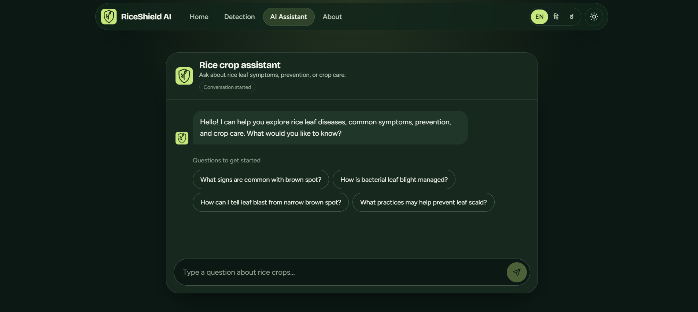
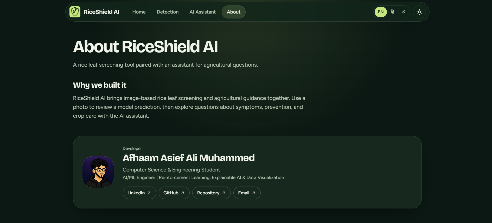

<div align="center">

# 🌾 RiceShield AI

### Intelligent Rice Leaf Disease Detection & Agricultural Assistance

An AI-powered platform that helps users screen rice leaves for common diseases and explore evidence-based agricultural guidance through a retrieval-augmented AI assistant.

[Features](#-features) · [System Architecture](#-system-architecture) · [Technology Stack](#-technology-stack) · [Setup](#-getting-started) · [API Reference](#-api-reference)

</div>

---

## 📸 Application Preview

### Home
The landing page introduces RiceShield AI and provides direct access to leaf screening and the agricultural assistant.



### Disease Detection
Upload a rice leaf image or use a camera to request a prediction. The interface is designed to present the predicted class and confidence details after analysis.



### Farmer Assistant
Ask agricultural questions about symptoms, prevention, and crop care. The assistant uses a retrieval-augmented generation (RAG) pipeline backed by agricultural documents.



### About
Learn about the platform and its developer.



---

## 🌱 Overview

RiceShield AI combines computer vision, deep learning, and large language models in one agricultural assistance platform. Its two main workflows are:

- **Rice leaf disease screening:** Classifies an uploaded image into a supported category and presents prediction confidence.
- **Agricultural question answering:** Retrieves relevant passages from a curated agricultural document collection and uses them to ground assistant responses.

The application is intended as a decision-support tool. Predictions and chatbot recommendations should be treated as guidance, not as a substitute for expert diagnosis or local agricultural extension advice.

## ✨ Features

### Disease Detection
- Rice leaf image classification using **EfficientNet-B3**
- Top-3 prediction probabilities
- Prediction confidence display
- Out-of-distribution (OOD) checks
- Rejection of images identified as non-rice leaves
- Image upload interface with camera support

### Farmer Assistant
- Natural-language question answering about rice diseases and crop care
- Retrieval-Augmented Generation (RAG)
- FAISS vector search
- Maximal Marginal Relevance (MMR) retrieval
- Cross-encoder re-ranking
- Context-aware conversations
- Responses grounded in a curated agricultural PDF knowledge base
- RAG evaluation using metrics such as Recall@K, Hit Rate, Mean Reciprocal Rank (MRR), faithfulness, and RAGAS

> **Evaluation note:** Reported model accuracy and RAG evaluation scores should be documented with their evaluation dataset, test protocol, and measured values. Do not interpret a UI placeholder or an unverified figure as a validated benchmark.

## 🦠 Supported Categories

The classifier is configured for the following categories:

| Category | Description |
|---|---|
| Bacterial Leaf Blight | A bacterial disease that can cause water-soaked lesions and leaf drying |
| Brown Spot | A disease associated with brown lesions on leaf surfaces |
| Leaf Scald | A disease that can produce characteristic scalded or zonate lesions |
| Leaf Blast | A fungal disease that may produce spindle-shaped lesions |
| Narrow Brown Spot | A disease associated with narrow, brown, linear lesions |
| Healthy Leaf | A leaf classified as healthy by the model |
| Non-Rice Leaf | An input rejected or classified as outside the supported rice-leaf domain |

Disease symptoms can overlap, and image-based classification may be uncertain. Confirm important treatment decisions with a qualified agricultural expert.

## 🧠 System Architecture

### 1. Disease Detection Pipeline

```text
Rice Leaf Image
      │
      ▼
Image Preprocessing
      │
      ▼
EfficientNet-B3 Classifier
      │
      ▼
Class Probabilities / Top-3 Results
      │
      ▼
OOD and Non-Rice Input Validation
      │
      ▼
Prediction and Confidence Details
```

### 2. Farmer Assistant Pipeline

```text
User Question
      │
      ▼
Query Rewriting
      │
      ▼
FAISS Document Retrieval
      │
      ▼
MMR Selection
      │
      ▼
Cross-Encoder Re-ranking
      │
      ▼
Relevant Document Context
      │
      ▼
Groq-hosted LLM
      │
      ▼
Source-grounded Answer
```

## 📚 Agricultural Knowledge Base

The assistant uses a curated collection of **30+ agricultural PDF documents** covering topics such as:

- Rice leaf diseases and symptoms
- Disease prevention and crop protection
- Treatment and management recommendations
- General rice crop care

Retrieved content is used to provide context for generated answers. The quality of responses depends on the coverage and reliability of the source documents, retrieval quality, and model behavior.

## 🛠️ Technology Stack

| Layer | Technologies |
|---|---|
| Frontend | React, Vite, i18next |
| Backend API | FastAPI, Python |
| Deep Learning | PyTorch, EfficientNet-B3 |
| Retrieval & RAG | LangChain, FAISS, BAAI embeddings |
| Re-ranking | Cross-encoder re-ranking |
| Language Model | Groq API |
| Deployment | Vercel, Hugging Face Spaces |

## 🗂️ Project Structure

```text
RICE-DISEASE-APP/
├── backend/
│   ├── app.py
│   ├── model.py
│   ├── pdfs/
│   ├── faiss_index/
│   └── rice_B3_pytorch.pt
├── frontend/
│   └── src/
│       ├── components/
│       ├── hooks/
│       ├── i18n/
│       └── pages/
└── README.md
```

*The structure above reflects the project layout described for this repository. Adjust filenames or folders if your current checkout differs.*

## 🚀 Getting Started

### Prerequisites

- Python version compatible with the backend dependencies
- Node.js and npm
- A valid Groq API key for the assistant
- The trained EfficientNet-B3 model weights and required FAISS index / knowledge-base files

### 1. Clone the repository

```bash
git clone <repository-url>
cd RICE-DISEASE-APP
```

Replace `<repository-url>` with the actual repository URL.

### 2. Configure the backend

Create a `.env` file in the backend directory (or the directory from which your application loads environment variables):

```env
GROQ_API_KEY=your_groq_api_key
```

Keep API keys private. Do not commit `.env` files or secrets to source control.

Install the backend dependencies using the project's dependency file, if available. For example:

```bash
cd backend
pip install -r requirements.txt
```

If the repository does not contain a `requirements.txt`, install the dependencies listed by the project and document the supported versions before deployment.

Start the API using the command appropriate to the project. A typical FastAPI command is:

```bash
uvicorn app:app --reload
```

Run this from the directory containing `app.py`, unless the project's configuration specifies otherwise.

### 3. Configure the frontend

Open a second terminal:

```bash
cd frontend
npm install
npm run dev
```

Vite will print the local development URL in the terminal.

### 4. Verify the application

- Open the frontend and confirm the API base URL points to the running backend.
- Upload a clear rice leaf image and inspect the predicted class and confidence values.
- Test non-rice inputs to verify the OOD / rejection behavior.
- Ask the assistant a question that should be covered by the agricultural PDFs.
- Confirm that the backend can access the model weights, FAISS index, and knowledge-base files.

> These commands are common defaults. Check the repository's actual dependency files, environment variable names, and startup configuration before running them.

## 🔌 API Reference

| Method | Endpoint | Purpose |
|---|---|---|
| `POST` | `/predict` | Predict a rice leaf category from an image |
| `POST` | `/chat` | Answer an agricultural question using the assistant pipeline |

For exact request schemas, accepted fields, response examples, and error codes, refer to the FastAPI route definitions or the automatically generated API documentation exposed by the running backend (commonly `/docs`).

## 📊 Evaluation

A robust evaluation should report the following separately:

### Image Classifier
- Test-set size and class distribution
- Accuracy, precision, recall, and F1-score
- Confusion matrix and per-class metrics
- Calibration or confidence behavior
- OOD / non-rice rejection performance

### Retrieval-Augmented Assistant
- Recall@K and Hit Rate
- Mean Reciprocal Rank (MRR)
- Faithfulness and answer relevance
- RAGAS results, with the evaluated dataset and configuration documented
- Source-grounding checks and failure cases

Use results from actual evaluation runs. Avoid presenting training accuracy as test accuracy or claiming performance that has not been independently measured.

## 🔐 Responsible Use

- Use clear, well-lit images with the leaf visible and in focus.
- Treat model output as a screening result, not a definitive diagnosis.
- Verify treatment recommendations against trusted local agricultural guidance.
- Protect API keys and avoid exposing private credentials in logs or frontend code.
- Keep the knowledge base current and review retrieved sources for relevance and reliability.

## 👨‍💻 Developer

**Afhaam Asief Ali Muhammed**  
Computer Science & Engineering Student  
Interests: AI/ML Engineering, Reinforcement Learning, Explainable AI, and Data Visualization

- [LinkedIn](#) · [GitHub](#) · [Repository](#) · [Email](#)

Replace the placeholder links above with the actual profile, repository, and contact URLs.

## 📄 License

This project is described as being licensed under the **MIT License**. Include the full MIT license text in a `LICENSE` file in the repository to make the licensing terms explicit.

---

<div align="center">

**RiceShield AI** · Supporting smarter rice-leaf screening and agricultural knowledge access.

</div>
